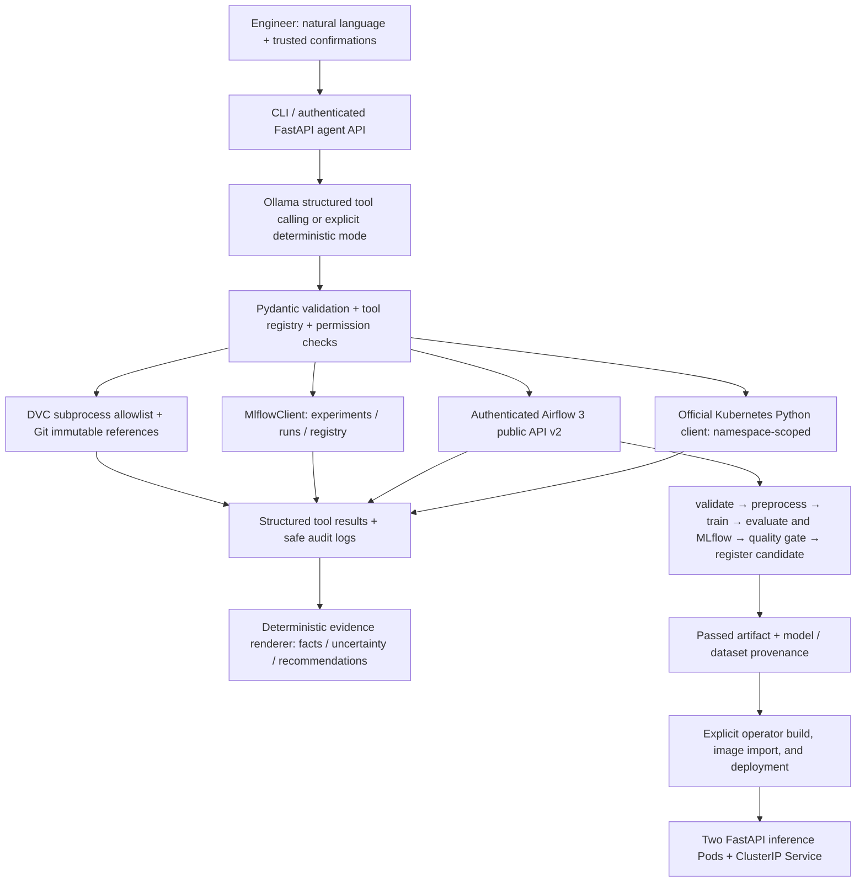

# System architecture

`Orchestrator` separates planning from execution and final reporting. The optional Ollama planner
uses the supported `/api/chat` tool-calling protocol. `AGENT_PLANNER=rules` provides bounded,
documented natural-language workflows without a model download; responses identify the planner
used. Model-generated prose is never treated as operational evidence. The final response is
rendered exclusively from successful tool outputs; failed calls produce explicit uncertainty.

Each tool has a name, JSON Schema input, description, Python handler, and optional exact-action
confirmation identifier. The executor validates inputs, checks confirmation, records elapsed
time and request ID, normalizes results, and removes credentials. The model can propose a
tool, but cannot create a trusted confirmation. Unknown tools and extra arguments are rejected.

DVC uses approved argument lists with `shell=False`; Git references resolve to immutable commit
IDs before reading pointers. Dataset identity is the DVC MD5 content address, distinct from the
code/dataset Git revision. Training verifies that both the workspace and committed DVC pointer
agree. MLflow records those references, split policy, metrics, parameters, model artifacts and
quality-gate state. Experiments are compared through their runs, including runs from different
experiments. Ranking considers recent FINISHED runs with finite metrics; a high score alone
does not prove production readiness.

Airflow uses JWT authentication through `/auth/token` and `/api/v2`, not the Airflow 2 API.
All tasks have one retry and explicit dependencies. Validation failure prevents every downstream
stage; quality-gate failure blocks candidate registration. Each DAG run has its own workspace.
Candidate registration never updates the serving deployment. Triggering a training run requires
`airflow.trigger_training:training_pipeline` confirmation and an allowlisted DAG.

Inference loads an artifact that passed its quality gate and validates configured run/hash identity
against the artifact. It exposes liveness, readiness, version and prediction endpoints. Readiness
fails if no model is loaded. The Docker image runs without root, and Kubernetes provides probes,
resource limits, a ConfigMap, a ClusterIP Service, and two desired replicas. Images carry the full
run ID, avoiding accidental reuse of a mutable image tag. Deployment diagnosis uses rollout
generation, updated/ready replicas, Pod states/restarts, events, bounded logs and Service endpoints.

The agent's default Kubernetes identity is read-only. Both read and write tools are restricted to
`mlops`; log access is also checked against application labels. A restart additionally requires
`kubernetes.restart_deployment:mlops:prediction-api`. Granting the optional patch Role to a
separate identity remains an administrator action. Inference Pods receive no API credentials.

The demonstration uses a local DVC filesystem remote, MLflow with SQLite/artifact proxying,
Airflow standalone, and a local k3s cluster. These are development service topologies. Production
would use durable remote storage, authenticated TLS endpoints, PostgreSQL, separate Airflow
components, short-lived identities, model signing, stronger approval records, and drift monitoring.

References: [Airflow 3 authentication](https://airflow.apache.org/docs/apache-airflow/3.1.5/security/api.html),
[MLflow tracking server](https://mlflow.org/docs/latest/tracking/server/),
[Ollama tool calling](https://docs.ollama.com/capabilities/tool-calling),
[DVC diff](https://dvc.org/doc/command-reference/diff),
[Kubernetes probes](https://kubernetes.io/docs/tasks/configure-pod-container/configure-liveness-readiness-startup-probes/).
